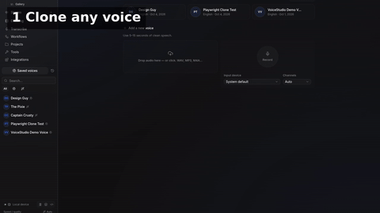

# 🎙️ VoiceStudio Experiments — Local AI Voice Lab


> **Abstract.** This repository proves, with playable audio and screenshots, that
> a complete AI voice studio — voice cloning, voice design, speech-to-text in
> three engines, video dubbing in Spanish and Arabic, multi-voice stories and
> audiobooks — runs **entirely on one local computer** (RTX 3090, ~8.6 GB of
> models, zero cloud, zero API keys for speech). Every claim below links to a
> real artifact in this repo. If you are new to voice AI, read the
> [🌱 Beginner guide](#-beginner-guide--read-this-and-you-are-a-professional)
> first — ten minutes there teaches you what most interview candidates cannot
> explain.



🎬 **[Watch the 30-second tour (demo.mp4)](demo.mp4)** · 🖼️ **[Open the visual showcase (preview.html)](preview.html)** — screenshots, audio players, and the full story in one beautiful page.

## Contents

- [🌱 Beginner guide — read this and you are a professional](#-beginner-guide--read-this-and-you-are-a-professional)
- [✨ Features — everything this lab demonstrates](#-features--everything-this-lab-demonstrates)
- [🧑‍🤝‍🧑 User stories — who is this repo for](#-user-stories--who-is-this-repo-for)
- [🧪 Experiments (with proof)](#-experiments-with-proof)
- [🔤 Standard Arabic zero-to-hero](#-standard-arabic-zero-to-hero)
- [🧠 Models used](#-models-used)
- [🖥️ Hardware — what you need](#️-hardware--what-you-need)
- [🚀 Reproduce it yourself](#-reproduce-it-yourself)
- [❓ FAQ](#-faq)
- [⚖️ Notes & licenses](#️-notes--licenses)

## 🌱 Beginner guide — read this and you are a professional

> Let's work this out in a step-by-step way to be sure we have the right answer.

**What is "voice AI"?** Three machines working in a chain:

1. **Ears (ASR — automatic speech recognition).** Turns sound into text.
   You upload a recording of someone saying *"Schedule a meeting…"* and get the
   sentence back as text. Accuracy is measured in *word error rate* — fewer
   wrong words is better.
2. **Brain (translation / language model, optional).** Turns text in one
   language into another, or decides what to say next.
3. **Mouth (TTS — text-to-speech).** Turns text into spoken audio in a chosen
   voice. *Voice cloning* means the mouth imitates a specific person from a
   5–15 second sample of them.

**The five words that make you sound professional:**

| Word | Plain meaning | Example in this repo |
|---|---|---|
| **Clone** | Copy a real voice from a short sample | `audio/01`, `audio/10–13` |
| **Design** | Invent a voice from a description, no sample needed | `audio/02` |
| **Transcribe** | Audio → text (the "ears") | Experiment 6 |
| **Dub** | Video in → same video speaking another language | Experiments 4–5 |
| **VRAM** | The GPU's own fast memory; big AI models live there | See `HARDWARE.md` |

**How a dubbing job flows (the whole pipeline in one paragraph):** upload video
→ extract its audio → transcribe it with timestamps (ears) → translate each
timed segment (brain) → speak every segment in the new language (mouth) →
stretch or fit each piece into its time slot → mix with the original video.
You can hear every stage in the files below.

## ✨ Features — everything this lab demonstrates

| Feature | What you do | Proof |
|---|---|---|
| 🎤 Voice cloning | 7-second sample → reusable voice | `audio/01`, `10–13` |
| 🎨 Voice design | Describe → new voice, no sample | `audio/02` |
| ⚡ Instant preset voices | 8 English voices, CPU-only, no cloning | `audio/03` |
| 🎞️ Video dubbing EN→ES | Full pipeline to a dubbed mix | `audio/04`, `screenshots/02` |
| 🌍 Arabic dubbing | Translation + Arabic speech, natural timing (stopped) | `audio/stopped-05–06`, `stopped-08` |
| 🔤 Standard Arabic MSA | Same MSA script in 6 voices, diacritized, verified | `audio/15`, `17–21`, `43` |
| 🗣️ MSA news bulletin | Formal 18 s bulletin, full tashkeel | `audio/22` |
| 🗣️ Native dialect voices | 8 native refs cloned, same-language render | `audio/44–51` |
| 🎧 Transcription ×3 engines | Same clips, Whisper Tiny vs Parakeet v3 | Experiment 6 |
| 📖 Stories & audiobooks | Multi-line scripts, M4B chapters | `audio/07`, `09` |
| 🎭 Multi-voice cast | 3 voices, one render, inline voice tags | `audio/09`, `screenshots/04` |
| 🖥️ Full app tour | 9 workspace screenshots + 30 s video | `screenshots/tour-*`, `demo.mp4` |

## 🧑‍🤝‍🧑 User stories — who is this repo for

- **🎬 The YouTuber.** Your video gets Spanish and Arabic voice tracks overnight,
  on your own PC — no per-minute cloud bill. See Experiments 4–5.
- **📚 The storyteller.** Write dialogue once, cast a villain, a child and a
  narrator, export an M4B audiobook. See Experiments 7–8.
- **🎙️ The podcaster.** Clone your own voice, then generate pickup lines and
  ad reads without re-recording. See Experiment 9 (`audio/10–13`).
- **🧏 The meeting-notes person.** Drop recordings in, get text out — offline,
  private. See Experiment 6.
- **🛠️ The builder.** Copy the reproduce steps, verify the API calls, extend
  with your own models. See `HARDWARE.md` + Reproduce.
- **🎓 The student.** Read the beginner guide, listen to every file, then
  explain the ASR→translate→TTS chain out loud. You will know more than most
  interview candidates.

## 🧪 Experiments (with proof)

*All rendered 2026-10-04 on RTX 3090 + VoiceStudio v0.5.6 (Docker, CUDA).
`audio/` holds WAV/MP3/M4B — press play on any file.*

### 1. Voice clone → new speech (`audio/01-clone-playwright-voice.wav`, 11.96 s)
Cloned `demo_voice.wav` (7.28 s reference) into *"Playwright Clone Test"*, then
generated a brand-new sentence:
> "This is a real clone test from the bundled demo voice, rendered locally on the
> RTX 3090. The voice was cloned from a seven second reference and speaks this
> new sentence."

### 2. Voice design (`audio/02-design-first-take.wav`, 7.1 s)
Designed voice (Narrator, middle-aged · low pitch), script:
> "Welcome aboard. I was just a three-second clip a moment ago — now I can say
> anything you'd like, in your voice or mine."

### 3. KittenTTS preset voice (`audio/03-kittentts-default-voice.wav`, 11.2 s)
`engine=kittentts` via the local API, no cloning step (presets are
`expr-voice-2/3/4/5-m/f`, default `expr-voice-2-f`):
> "Hello from Kitten, the tiny turbo voice. Eight presets, English only, renders
> in a blink on plain CPU."

### 4. Video dub EN→ES (`audio/04-dub-spanish-mix.wav` + `screenshots/02`)
`source.mp4` (11 s) → transcribe (2 timed segments: 0:00–0:04.5, 0:04.8–0:11.0)
→ Argos `en→es` → TTS → mux. Status path: Extracting → Transcribing →
Translations ready → **Dub complete**.

### 5. Arabic TTS — STOPPED (`audio/stopped-05-dub-arabic-seg1.wav` 6.0 s, `audio/stopped-06-dub-arabic-seg2.wav` 8.7 s)
Argos `en→ar` translation rendered to Arabic speech with OmniVoice.
Finding: the UI dub page blocks generic "Arabic" (*Choose a supported language*)
because the engine's 646 display names list dialects but no plain "Arabic" —
the backend (`supported_languages = ["multi"]`) synthesizes `ar` fine, so this
went through the API.

### 5b. Arabic v2 — natural rate — STOPPED (`audio/stopped-08-dub-arabic-v2-natural-rate.wav`, 15.4 s mix)
V1 sounded rushed: the job used `strict_slot` timing (6.0 s squeezed into 4.7 s).
V2 fixes the wording (e.g. التلاعب بالفيديو → دبلجة الفيديو, feminine verbs →
neutral) and re-renders with `stretch_video` timing — speech at natural rate
(6.71 s + 8.03 s), video yields instead of the voice. Same Speaker-1 clone.

### 6. Transcription shootout (Whisper Tiny vs Parakeet v3, same clips)
`en_conversational.wav` → **both word-perfect**:
> "Schedule a meeting with Pat for Tuesday at 3 p.m. and remind me to bring the
> quarterly report."
`en_technical.wav` → near-tie on jargon (Tiny: "renderer.to 6", Parakeet:
"renderer.tisx"; Parakeet punctuates better).
`fr_reservation.wav` → Parakeet auto-detected French:
> "Bonjour, je voudrais réserver une table pour deux personnes à 20 heures."

### 7. Story render (`audio/07-lighthouse-story.m4b` + `.mp3`, 0:59 + `screenshots/03`)
Sample story *"The Lighthouse at Wits' End"* (2 chapters, 151 words, pauses and
`[laughter]`/`[sigh]` markup) → M4B audiobook with chapters.

### 8. Multi-voice story (`audio/09-pirate-and-pixie-3voices.m4b` + `.mp3`, 0:24 + `screenshots/04`)
*"The Pirate and the Pixie"* — 4 lines, 3 voices in one render: narrator
(Demo Voice), villain (Gallery archetype **Captain Crusty**), child (Gallery
archetype **The Pixie**). Archetypes join via Gallery → Use voice → per-line
`[voice:<id>]` inline tags. Zero downloads.

### 9. "Design Guy" sessions (`audio/10`–`13`)
The voice from experiment 2 cloned into a reusable profile (*Design Guy*),
then four new takes: movie trailer (`10`, 4.4 s), comedy ad (`11`, 6.7 s),
story opening (`12`, 6.1 s), secret (`13`, 6.5 s).

## 🔤 Standard Arabic zero-to-hero

> From zero (what `arb` even is) to hero (the same MSA sentence speaking in
> six different voices). All rendered 2026-10-11 on RTX 3090 + VoiceStudio
> v0.5.6 (Docker, CUDA, OmniVoice `k2-fsa/OmniVoice`). Press play on
> `audio/15` → `17`–`21` in order — six voices, one script. (Earlier v1/v3
> takes were removed after verification; their findings are kept below.)

### Zero — what Standard Arabic is here

- **ID `arb`, ISO `arb`, 1483.53 hours** — the largest Arabic entry in
  `docs/languages.md` (rank 534) and `docs/lang_id_name_map.tsv`. Formal
  broadcast MSA, not a dialect. Siblings: Najdi `ars` 203 h, Moroccan `ary`
  104 h, Gulf `afb` 98 h, Egyptian `arz` 23 h, Hijazi `acw` 22 h, Levantine
  `apc` 15 h — 21 Arabic entries total, 646 languages overall (verified live
  via `GET /engines`: `has_standard_arabic True`, `output_sample_rate 24000`,
  `supports_cloning True`).
- **Model on disk:** `k2-fsa/OmniVoice` 2.4 GB (3.1 GB hub cache, 8 files),
  `installed True`, active engine `omnivoice` + `omnivoice-subprocess`
  available. ASR fallback for Arabic is Whisper (`faster-whisper-large-v3` /
  turbo-ct2) — Parakeet's 25 EU languages explicitly exclude Arabic, so
  dictation/transcription stays multilingual Whisper by design.
- **Why MSA is hard:** written Arabic omits short vowels, so مرحبا / للغة /
  الفصحى each admit several readings; brand names (`VoiceStudio`, `RTX 3090`)
  and numbers add code-switching; an English reference voice leaks an accent
  into cross-lingual cloning (documented OmniVoice tip). OmniVoice trains on
  both voweled and unvoweled text (mostly unvoweled, no preprocessing), so
  ambiguous words are guessed — see upstream issue `k2-fsa/OmniVoice#135` and
  the 2026 findings that diacritized training is better but scale compensates
  (`arXiv 2603.01622`), plus the OmniVoice paper's Arabic score (WER 1.392,
  SIM 0.776 — top of its table).

### The ladder — how v2 won (same machine, same engine)

| Take | File | Script rule | Result |
|---|---|---|---|
| v2 — **the best** | `audio/15-standard-arabic-v2-diacritized.wav` (8.73 s, gen 1.64 s, seed 634360819) | Full tashkeel on every word + Latin `VoiceStudio` + 3 short sentences + `RTX 3090` (backend expands to words automatically) | Both real fixes land: article preserved, emphatic S correct; brand stays intact; numbers handled. Cost: endings over-pronounced (`ikhtibarun`, `yamalun`) |

Removed after verification: v1 (undiacritized, transliterated brand — 4 round-trip
errors: greeting ending dropped, brand heard as Latin `View Studio`, article dropped,
emphatic S → plain S) and v3-light (minimal tashkeel — kept both fixes, dropped the
ending side effects, but not liked). Onset `marhaba→marhab` persisted in all three —
systematic, needs Whisper-large + human listen to attribute (TTS onset vs tiny-ASR
clipping).

Round-trip method (2026 best practice): synth → `POST /transcribe` → score
vs input with dual ASR + speaker similarity + UTMOS, then native-listener
DMOS/SMOS/NMOS. Our loop used the live Conformer (`sherpa-onnx-asr`,
~1–2 s) as a fast gate; numbers/code-switches (`RTX …`, `580 and 480`)
are known tiny-ASR failures, not proven TTS faults.

### Hero — one script, six voices (`audio/15`, `17`–`21`)

v2 text frozen (126 chars, Language `Arabic arb`, Balanced, VV-tuned
settings), only the voice changes. Clone voices render in Clone, designed
voices in Design (language re-pinned to Arabic each time — designed voices
reset it to English on switch).

| File | Voice | Type | Dur / gen | Round-trip note |
|---|---|---|---|---|
| `15` | VoiceStudio Demo Voice (VV) | clone | 8.73 s / 1.64 s | Reference take — the best MSA |
| `17` | Design Guy (DG) | clone | 8.54 s / 1.52 s | **Greeting WITH alif correct** — onset fix is voice-dependent, not script |
| `18` | Playwright Clone Test (PT) | clone | 8.77 s / 1.42 s | Greeting correct, `RTX 30.0` |
| `19` | Canadian Whisper (CW) | designed whisper | 8.44 s / 1.56 s | Greeting correct, code-switch `The Lath` (tiny-ASR) |
| `20` | The Pixie (TP) | designed child high | 8.55 s / 1.38 s | Words fuse at child rate — needs large-ASR confirm |
| `21` | Captain Crusty (CC) | designed elderly low | 8.6 s / 1.3 s | Spelling-correct `marhaba` without alif, article drops again, numbers `580 and 480` (low-pitch ASR worst case) |

Play 15 vs 17 vs 18 for the cleanest MSA narrators; 19 for whisper
character; 20/21 for cast extremes. All 24 kHz mono, `POST /generate 200`,
console 0 errors, history count 21.

Algorithm proof on unseen text: `audio/43-standard-arabic-v2-new-text-proof.wav`
(12.44 s, gen 1.84 s) renders brand-new words (`تجربة`, `خطوة`, `ثابتة`,
`استمعوا`) with the same v2 recipe — full tashkeel, Latin `VoiceStudio`,
short sentences, `arb` pinned. Round-trip keeps `باللغة العربية` correct;
voweled endings stay noisy on tiny-STT (predicted), Whisper-large + human
listen is the real gate.

### Reproduce (5 minutes)

```sh
# 1. Same stack
docker compose -f deploy/docker-compose.yml --profile gpu up  # RTX 3090, v0.5.6
# 2. Clone → voice → Language: type "Standard Arabic" → option Arabic العربية arb
# 3. Paste v2 (full tashkeel + Latin brand):
#    مَرْحَبًا بِكُمْ في VoiceStudio. هَذا اِخْتِبارٌ شامِلٌ لِلُّغَةِ الْعَرَبِيَّةِ الْفُصْحى. يَعْمَلُ مَحَلِّيًّا على RTX 3090.
# 4. Synthesize → Latest take 8–9 s → Check audio → POST /transcribe to score
# 5. Switch voice, re-pin Language Arabic (designed voices reset it), repeat
```

Rules that earned their keep: diacritize only ambiguous words/names/passives
(SESTEK/Vocla 2026); brands and codes stay Latin; one date/digit format;
short sentences with real punctuation; same-language 10–20 s reference for
production (ours used the English demo voice to isolate the script variable —
an Arabic MSA reference is the documented next gain); numbers via
`normalize_text`/words path.

### 10. MSA news bulletin (`audio/22`)

Keeper from a removed 21-country English-voice round: the other 20 takes
(`23`–`42`) were superseded by the native voices of Experiment 11 and deleted.
What remains is the formal MSA control — full classical tashkeel *with* i'rab,
the only variety where case endings belong.

| File | Country scene | ID | Dur | Round-trip markers heard (tiny STT) |
|---|---|---|---|---|
| `22` | MSA news bulletin | arb | 18.2 s | newsreader intact, full tashkeel |

Next gate before casting any voice: Whisper-large-v3 rescore +
native-speaker DMOS/SMOS/NMOS per Habibi §2.3. The 20 dialect siblings
(`23`–`42`) were removed after the native voices of Experiment 11 superseded
them; their transcripts are preserved in git history.

### 11. Native dialect voices — same-language cloning (`audio/44`–`51`)

Experiments 1–10 all clone English voices speaking Arabic (cross-lingual: the
reference accent leaks, arXiv Sep 2026 measured it on OmniVoice itself). The
fix needs no retraining: clone a *native* clip, then render dialect text with
the matched ID. Reference clips come from open benchmarks — Habibi
(`SWivid/Habibi`, 11k utterances, 7 dialects, 3–12 s, Arabic-script verified):
EGY idx 7 (9.28 s, MGB-3 Cairo speech, Apache 2.0), SAU idx 13 (6.47 s, SADA
Gulf speech, CC-BY-NC-SA-4.0), ALG idx 11 (9.23 s talk show), IRQ file-2 idx 10
(7.92 s football), MAR idx 26 (8.66 s cooking), UAE idx 5 (9.53 s market) —
plus Jordanian travel speech (`xtz999/jordanian_arabic_speech_nasir` idx 57,
`بدي`-Levantine) and Tunisian-only audio (`tunis-ai/TunSwitch` TO clip
48_01_02_3wz, 10.29 s, AAC→16 kHz wav; no transcript shipped, server
auto-transcribed). Re-pull Habibi rows with
`hf_hub_download('SWivid/Habibi', 'EGY/...parquet')`. Cloned via
`POST /profiles` and rendered via `POST /generate` with the matched country
text + ID — all HTTP 200, all md5-distinct.

| File | Voice ref | Text + ID | Dur | Round-trip |
|---|---|---|---|---|
| `44` | Egyptian native 9.28 s | Cairo cafe `arz` | 14.66 s | `ازيك`, `عايز` audible — Egyptian speaking Egyptian |
| `45` | Najdi native 6.47 s | Riyadh invite `ars` | 12.34 s | `ملكة`, `فهد` audible — Najdi speaking Najdi |
| `46` | Algerian native 9.23 s | Algiers shop `arq` | 22.02 s | سومة/ضمان audible; onset weak — re-listen |
| `47` | Iraqi native 7.92 s | Baghdad souq `acm` | 13.32 s | سمج, زينة audible |
| `48` | Moroccan native 8.66 s | Casa market `ary` | 13.48 s | `دابا`-region audible; weak overall (known MAR ASR failure) |
| `49` | Gulf native 9.53 s | Majlis `afb` | 22.56 s | زين audible; onset weak first render — re-listen |
| `50` | Levantine native ~8 s | Beirut morning `apc` | 17.63 s | `بدي`-region audible |
| `51` | Tunisian native 10.29 s | Tunis market `aeb` | 24.82 s | برشا-region audible; AAC-source ref, weakest — human listen |

Each native take re-speaks its country's scene from the removed English-voice
set — same words, native vocal tract. That A/B isolates the accent transfer;
the removed takes' transcripts are preserved in git history.
Still no open native clips for 12 IDs (saharan, baharna, chadian, dhofari,
bedawi, hijazi, judeo-moroccan, libyan, n-mosul, omani, saidi, sudanese) —
documented gap; same recipe applies the day clips surface (FLEURS, Common
Voice, vendor recordings with consent).

## 🧠 Models used

| Model | Size | Job |
|---|---|---|
| `k2-fsa/OmniVoice` | 2.4 GB | TTS: clone, design, stories, dub voice |
| `Systran/faster-whisper-large-v3` | 2.9 GB | ASR: best word timestamps (dubbing) |
| `deepdml/faster-whisper-large-v3-turbo-ct2` | 1.6 GB | ASR: 5× faster transcription |
| `csukuangfj/sherpa-onnx-whisper-tiny` | 245 MB | Live dictation, 90+ langs, CPU |
| `csukuangfj/sherpa-onnx-nemo-parakeet-tdt-0.6b-v3-int8` | 682 MB | Best EN/EU dictation accuracy |
| `KittenML/kitten-tts-mini-0.8` | 110 MB | Instant English preset voices, CPU |
| Argos offline packs | ~100–200 MB each | `en↔es`, `en→ar`, `ar→en` translators |

> What each model costs in VRAM/RAM/CPU, and what smaller machines need:
> see **[HARDWARE.md](HARDWARE.md)**.

## 🖥️ Hardware — what you need

Short version: an **8 GB+ VRAM NVIDIA card + 16 GB RAM** is the sweet spot;
no GPU still works (slower); this lab's 3090 is ~3–4× overprovisioned. Full
per-model table, smaller-machine guidance and tuning knobs: **[HARDWARE.md](HARDWARE.md)**.

## 🚀 Reproduce it yourself

```sh
# 1. Start VoiceStudio (GPU profile)
docker compose -f deploy/docker-compose.yml --profile gpu up
# 2. Open http://localhost:3900 and complete setup.
#    Models install one-click from Settings → Models.
#    No HuggingFace token needed — all are public.
# 3. Workspaces, in the order of this repo:
#    Clone a voice → Design → Transcribe → Dub → Stories.
```

## ⚖️ VoiceStudio vs ElevenLabs — honest comparison

[ElevenLabs](https://elevenlabs.io) is the commercial reference: best-in-class
voice quality, zero setup, works from any browser. This lab exists to answer one
question — *how close can you get for $0, on your own hardware, with nobody
else hearing your audio?* Prices below verified September 2026.

| | VoiceStudio (this lab) | ElevenLabs |
|---|---|---|
| **Price** | $0 forever (electricity only) | Free trial ~10 min/mo, then $6–$990/mo; ~$0.17–0.20 per finished minute |
| **Limits** | Unlimited renders; only your GPU speed caps you | Monthly credit pool (e.g. 30k ≈ 30 min on Starter); every regenerate re-bills; dubbing burns ~13,500 credits/min |
| **Privacy** | Audio/text never leave your PC | Audio + text go to their cloud by design |
| **Offline** | Yes, after one-time model downloads | No — browser + account + connection required |
| **Voice cloning** | 5–15 s sample, unlimited voices | Instant cloning from Starter ($6); single best-in-class quality |
| **Dubbing** | 1 language per run, offline translators | 29 languages, polished Dubbing Studio, per-minute billing |
| **Weak spots here** | Needs a gaming-grade GPU for speed; Arabic needed manual fixes (see §5b) | Costs money forever; free tier is non-commercial with attribution |

Rule of thumb: ElevenLabs wins on polish and convenience; this setup wins on
cost (unlimited), privacy (total), and ownership (yours). For drafts, bulk
work, private material, or learning — local wins. For the final 5% of
commercial polish on one hero video — rent the cloud for that render.

## ❓ FAQ

**Do I need the internet?** Only to download models once. After that, unplug —
everything above renders offline.

**Do I need an API key or account?** No. Not for speech, not for models.

**Why do some files come in pairs (`.m4b` + `.mp3`)?** M4B is the audiobook
format with chapters; MP3 plays literally everywhere. Same audio, pick either.

**Why does the Arabic dub sound faster in v1?** Slot-fitting sped it 1.3×.
Listen to v2 (`stopped-08`) — natural rate. Details in experiment 5b.

**Why was v1 Arabic mispronounced but v2 (15) better?** v1 (file removed) had no
tashkeel and a transliterated brand — the model guessed. v2 adds full
voweling on the ambiguous words and keeps `VoiceStudio`/`RTX 3090` in Latin:
article and emphatic-S get fixed; full voweling over-pronounces endings.
Full forensics in the Standard Arabic section above.

**Can my computer run this?** Probably yes — see `HARDWARE.md`.

**Can I contribute?** Yes — new experiments (a French dub, a full audiobook
chapter, a new voice) are welcome: add audio + a README section + screenshots,
keep every claim linked to a file.

## ⚖️ Notes & licenses

- Audio here is synthetic; VoiceStudio watermarks generations invisibly by
  default. Voices used: the bundled demo voice, its test clones, and synthetic
  gallery archetypes (no real private individual).
- VoiceStudio is AGPL-3.0; model weights carry their own licenses (review before
  commercial use); clone voices only with permission.
- This repo's own text and scripts: MIT — see `LICENSE`.
- Two hiccups hit during the session, both recovered: transient download stalls
  (resume/retry completed them) and a browser re-auth gate after backend
  idle-unload (re-enter the API key).
